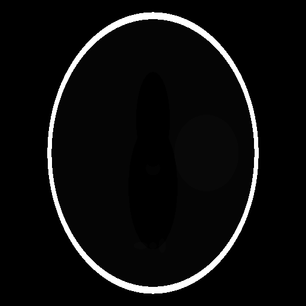
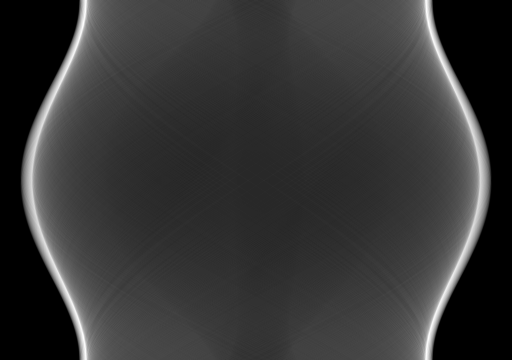
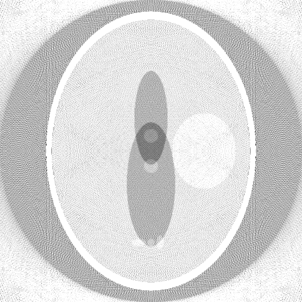

# ct-fbp-cuda

基于 CUDA 的 CT 图像**滤波反投影（FBP, Filtered BackProjection）**重建器：
从模拟 X 光扫描到 GPU 加速重建的完整流水线，附 CPU 参考实现与性能对比。

```text
 Shepp-Logan 体模 → 前向投影(Radon) → 正弦图 → Ramp 滤波 → 反投影 → 重建图像
        │                │                          │            │
      phantom.cu    projector_cpu / gpu        filter_cpu / gpu  backprojector_cpu / gpu(naive+texture)
```

- **正确性可验证**：GPU 与 CPU 逐阶段比对（重建图逐点误差 ~1e-6），RMSE/PSNR 自动输出
- **性能可量化**：512×512×360 配置下反投影加速 **~600×**（RTX 5070 vs 单线程 CPU）
- **零第三方依赖**：图像 IO 为自写 PGM 读写，FFT 为 cuFFT(GPU) / 自写 radix-2(CPU)

## 原理速览

**前向投影**（模拟扫描，Radon 变换）：对每个角度 θ，沿一束束平行射线积分图像，
得到 1D 投影 p(θ,s)。所有角度按行堆叠即**正弦图**（离中心 (x₀,y₀) 的点划出
s = x₀cosθ + y₀sinθ 的正弦轨迹）。

**Ramp 滤波（Ram-Lak）**：反投影 inherently 对高频欠加权，会得到模糊图像；对正弦图
**每行**做 1D 高通滤波（频响 |ν|）预先补偿。实现走 FFT 域，可乘 Hamming 窗抑制振铃。

**反投影**：输出图像每个像素 (x,y) 对所有角度计算 s = x·cosθ + y·sinθ，去该角度
的投影行里**线性插值**查 s 处的值，累加后乘 Δθ。查值插值正是 GPU 优化的核心：
texture memory 的硬件双线性插值可以把两次全局读 + 插值指令压成一条 `tex2D`。

参考：Kak & Slaney, *Principles of Computerized Tomographic Imaging*, Ch.3（[官方免费 PDF](https://www.slaney.org/pct/pct-toc.html)）。

## 坐标与几何约定

全项目（CPU/GPU 共用，见 `include/geometry.h`）：

```text
归一化视野 [-1,1]²，图像 N×N（row-major，index = i*N+j）
  第 i 行(自上而下)、第 j 列(自左向右)的像素中心：
    x = -1 + (j+0.5)·dx        （列 → +x 向右）
    y = +1 - (i+0.5)·dx        （行 0 在顶 = +y 向上，符合图像显示习惯）
探测器 n_det 单元：s_k = -1 + (k+0.5)·ds
角度 θ_i = i·π/n_angle 覆盖 [0°,180°)
射线参数化：x = s·cosθ − t·sinθ，y = s·sinθ + t·cosθ（t 沿射线方向）
```

前向/反向使用同一 s = x·cosθ + y·sinθ，自洽；单椭圆正弦轨迹测试
（`tests/test_pipeline.cpp`）锁定这套约定不被改坏。

## 构建（Windows）

要求：

- CUDA Toolkit ≥ 12.8（开发环境为 13.1；Blackwell 显卡需要 12.8+ 才有 sm_120）
- CMake ≥ 3.24
- Visual Studio 2022/2026（MSVC 14.2x~14.4x；见下方说明）
- Ninja（VS 自带：`Common7/IDE/CommonExtensions/Microsoft/CMake/Ninja/`）

一条命令（推荐，内部自动选 14.44 工具集 + Ninja）：

```bat
scripts\build.bat
```

或手动：

```bat
call "C:\...\VC\Auxiliary\Build\vcvarsall.bat" x64 -vcvars_ver=14.44
cmake -S . -B build -G Ninja -DCMAKE_BUILD_TYPE=Release
cmake --build build
```

> **注意**：nvcc（≤13.1）只支持 MSVC 2019~2022（19.2x~19.4x）作为 host 编译器。
> 若默认工具集是 VS2026 的 19.51（如本开发机），用 `-vcvars_ver=14.44` 固定到
> 已装的 VS2022 时代工具集即可。若用 VS 生成器打开 `.sln`，还需在 VS 安装器里
> 勾选 CUDA 的 "Visual Studio Integration" 组件（本仓库默认走 Ninja，无此依赖）。

目标架构默认 `sm_120`（RTX 50 系）；其他显卡用
`-DCMAKE_CUDA_ARCHITECTURES=86`（30 系）/`89`（40 系）等覆盖。

## 用法

```bat
build\ct_fbp.exe                              :: 默认 512×512, 512 探测器, 360 角度, CPU+GPU 对比
build\ct_fbp.exe --size 1024 --angles 720 --det 1024
build\ct_fbp.exe --mode cpu                   :: 只跑 CPU
build\ct_fbp.exe --filter hamming             :: Hamming 窗对比
build\ct_fbp.exe --out docs/results           :: 指定输出目录
```

| 选项 | 默认 | 说明 |
|---|---|---|
| `--size N` | 512 | 图像边长 N×N |
| `--det D` | 512 | 探测器单元数 |
| `--angles A` | 360 | 投影角度数（覆盖 0~180°） |
| `--mode M` | both | `cpu` / `gpu` / `both`（both 时逐阶段比对） |
| `--filter F` | ram-lak | `ram-lak` / `hamming` |
| `--warmup W` | 3 | GPU 计时前预热次数 |
| `--runs R` | 5 | 计时重复次数取平均 |
| `--out DIR` | output | 输出目录 |

输出：`phantom.pgm`、`sinogram.pgm`、`sinogram_filtered.pgm`、
`recon_cpu.pgm`、`recon_gpu.pgm`、`recon_gpu_texture.pgm`（重建图统一灰阶），
以及控制台的质量/性能报告和 `timings.csv`。
PGM 可用 IrfanView/GIMP 等查看，或 `python tools/pgm2png.py xxx.pgm` 转 PNG。

## 测试

```bat
build\test_pipeline.exe       :: 或 cmake --build build --target test
```

覆盖：PGM 读写往返、单椭圆正弦轨迹（坐标约定）、中心圆盘 FBP 定标
（重建值 ≈ 1）、Shepp-Logan CPU 全流程 RMSE、GPU vs CPU 逐阶段一致性。

## 结果（RTX 5070 / CUDA 13.1）

完整数据见 [docs/results/RESULTS.md](docs/results/RESULTS.md)。

| 配置 | 阶段 | CPU (ms) | GPU naive (ms) | 加速比 | GPU texture (ms) |
|---|---|---|---|---|---|
| 512×512×360 | 前向投影 | 584.6 | 0.99 | 591× | — |
| 512×512×360 | Ramp 滤波 | 33.1 | 0.05 | 672× | — |
| 512×512×360 | 反投影 | 193.8 | 0.32 | **600×** | 0.25 |

| 配置 | RMSE | PSNR |
|---|---|---|
| 256×256×180 | 0.0458 | 26.95 dB |
| 512×512×360 | 0.0334 | 29.69 dB |
| 1024×1024×720 | 0.0250 | 32.21 dB |

| 体模 | 正弦图 | 重建（窄窗口） |
|---|---|---|
|  |  |  |

## 实现说明

| Kernel | 线程映射 | 要点 |
|---|---|---|
| 前向投影 | 1 线程 = 1 (角度, 探测器) | 等距步进采样 + 双线性插值；积分范围按外接圆 \|t\| ≤ √(2−s²) 截断省 ~35% 空步 |
| Ramp 滤波 | 1 线程 = 1 补零元素 / 频域元素 | cuFFT 批量 1D C2C；plan/频响/缓冲按几何缓存，重复调用零额外开销 |
| 反投影 v1 naive | 1 线程 = 1 像素 (16×16 block) | cos/sin 预计算查表，手写线性插值，出界取 0 |
| 反投影 v2 texture | 同上 | 正弦图驻留 cudaArray，`tex2D` 硬件双线性插值 |

细节：

- **1/M 归一化折叠进频响**：`q = IFFT(FFT(p)·|ν_m|·w_m/M)`，CPU 自写 FFT 与
  cuFFT 均不带归一化，两侧数学完全一致（滤波后正弦图误差 ~1e-6·量级）。
- **texture 插值量化**：硬件线性过滤的小数权重按 1/512 步长量化，对重建图引入
  ~1e-4 的 RMSE，肉眼不可分辨；换来纹理缓存命中 + 免插值指令，512 配置快 ~22%。
- **缓存策略**：三角函数表、cudaArray/texture object、cuFFT plan 均按几何/源指针
  静态缓存，计时循环内无重复分配；texture 版每次调用含一次 D2D 拷贝（0.7 MB，计入计时）。
- **计时口径**：CUDA Events 只含设备端计算，H2D/D2H 拷贝在计时区外；CPU 为
  `std::chrono` 单线程。

## 目录结构

```text
ct-fbp-cuda/
├── CMakeLists.txt
├── scripts/build.bat        # Windows 一键构建（vcvars + Ninja）
├── tools/pgm2png.py         # PGM→PNG 显示辅助（需 Pillow）
├── include/                 # 公共 API：geometry/phantom/projector/filter/backprojector/io/metrics/timer
├── src/                     # 实现：CPU 参考版 + GPU kernels（.cu）
├── tests/test_pipeline.cpp  # 零依赖一致性测试
└── docs/results/            # 输出图像 + 质量性能报告
```

## 扩展路线

- **扇束 FBP**：点光源几何 + cos³ 权重（等距重排或直接扇束公式）
- **迭代重建（SIRT/ART）**：少角度场景质量优于 FBP，投影/反投影 kernel 可直接复用
- **Siddon 精确前向投影**：替代等距采样，消除采样步长依赖
- **多 GPU / 流水线重叠**：滤波与反投影用 CUDA stream 重叠
