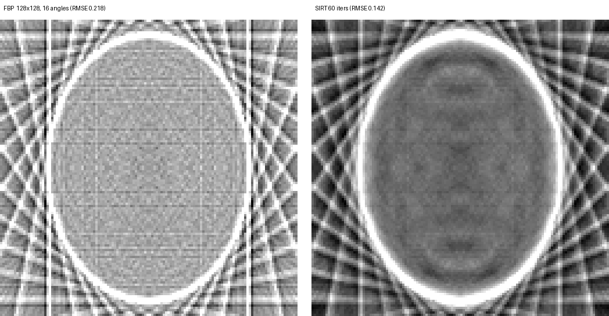

# 质量与性能报告

> 测试环境：Windows 11 + NVIDIA GeForce RTX 5070 (sm_120, 12 GB) + CUDA 13.1 + 驱动 621.01
> 编译：CMake + Ninja + MSVC 14.44 (VS2022 工具集) + nvcc `-O2`，`CMAKE_CUDA_ARCHITECTURES=120`
> 计时口径：CPU 预热 1 次后取 5 次均值（`std::chrono`，单线程）；GPU 预热 3 次后取 5 次均值
> （CUDA Events，只含 kernel/FFT 计算，不含 H2D/D2H 拷贝）。表中数字为单次采集，
> CPU 侧受后台负载影响约 ±10%，微秒级 GPU 数值有 ±30% 抖动；趋势与量级可复现。

## 0. 复现命令

```bat
:: FBP：512 主配置 / 少角度小配置
build-ninja\ct_fbp.exe --size 512 --det 512 --angles 360 --out output\final512
build-ninja\ct_fbp.exe --size 128 --det 128 --angles 16  --out output\fbp128_16

:: SIRT：16/32/64 角度，60 与 200 次迭代，fp16 / fp32 / 统一内存
build-ninja\ct_fbp.exe --size 128 --det 128 --angles 16 --recon sirt --iters 60  --matrix fp16 --out output\sirt128
build-ninja\ct_fbp.exe --size 128 --det 128 --angles 64 --recon sirt --iters 200 --matrix fp16 --out output\sirt128_64_200

:: 前向投影变体 / 异步流水线 / 多 GPU / CUDA Graphs
build-ninja\ct_fbp.exe --size 512 --det 512 --angles 360 --mode gpu --forward warp --out output\fwd_warp
build-ninja\ct_fbp.exe --size 512 --det 512 --angles 360 --mode gpu --streams 4 --out output\stream512
build-ninja\ct_fbp.exe --size 512 --det 512 --angles 360 --mode gpu --mgpu --out output\mgpu512
build-ninja\ct_fbp.exe --size 512 --det 512 --angles 360 --mode gpu --graph --out output\graph512

:: 知识点巡礼 + 全量测试
build-ninja\ct_tour.exe
build-ninja\test_pipeline.exe
```

## 1. FBP 重建质量（vs Shepp-Logan 体模，Ram-Lak 滤波）

| 配置 | RMSE | PSNR | GPU vs CPU 重建图 rmse (naive / texture) |
|---|---|---|---|
| 256×256, 180 角度 | 0.0458 | 26.95 dB | 6.2e-7 / 3.1e-4 |
| 512×512, 360 角度 | 0.0334 | 29.69 dB | 9.1e-7 / 1.6e-4 |
| 1024×1024, 720 角度 | 0.0250 | 32.21 dB | 1.2e-6 / 9.0e-5 |

分辨率越高、角度越密，模糊与离散化误差越小，PSNR 随之上升；
GPU naive 与 CPU 参考（单线程）逐点误差在 1e-6 量级，texture 版因硬件插值
小数权重 1/512 量化引入 ~1e-4 的 RMSE，肉眼不可分辨。

## 2. 各阶段 GPU vs CPU 一致性（512×512×360）

| 阶段 | max_abs | rmse |
|---|---|---|
| 正弦图（前向投影） | 2.64e-06 | 1.01e-07 |
| 滤波后正弦图（cuFFT vs 自写 FFT） | 1.41e-04 | 6.48e-06 |
| 重建图 naive | 9.48e-06 | 9.06e-07 |
| 重建图 texture | 4.83e-03 | 1.63e-04 |

全部满足计划验收标准（正弦图 < 1e-3，重建图肉眼一致）。

## 3. FBP 各阶段性能（ms，均值）

### 前向投影

| 配置 | CPU | GPU naive | 加速比 |
|---|---|---|---|
| 256×256×180 | 68.83 | 0.14 | 479× |
| 512×512×360 | 599.28 | 1.03 | 581× |
| 1024×1024×720 | 5691.26 | 9.83 | 579× |

### Ramp 滤波

| 配置 | CPU（自写 FFT） | GPU（cuFFT） | 加速比 |
|---|---|---|---|
| 256×256×180 | 4.95 | 0.05 | 107× |
| 512×512×360 | 33.94 | 0.05 | 637× |
| 1024×1024×720 | 104.11 | 0.07 | 1601× |

### 反投影（计划目标：512 配置 ≥ 50×，实测 ≈ 580×）

| 配置 | CPU | GPU naive | 加速比 | GPU texture | texture 相对 naive |
|---|---|---|---|---|---|
| 256×256×180 | 21.19 | 0.06 | 351× | 0.06 | 0% |
| 512×512×360 | 188.16 | 0.32 | 583× | 0.25 | -22% |
| 1024×1024×720 | 1584.01 | 2.46 | 644× | 1.81 | -26% |

texture 版在 512 及以上配置稳定领先：正弦图驻留 cudaArray 后，按 (角度, 探测器)
的访问全部命中纹理缓存，硬件插值替代了手写的两次全局内存读取 + 插值指令。
256 配置下 kernel 只有 60 µs，纹理对象绑定/解绑的固定开销与省下的指令打平。

## 4. 滤波窗对比（512×512×360）

| 滤波 | RMSE | PSNR | max_abs |
|---|---|---|---|
| Ram-Lak（纯 ramp） | 0.0334 | 29.69 dB | 0.358 |
| Hamming（ramp×窗） | 0.0444 | 27.23 dB | 0.424 |

Shepp-Logan 边缘锐利，Ram-Lak 的 RMSE 更优；Hamming 换来了内部平坦区域的
平滑（振铃被抑制），适合噪声数据。两者均为一次开关切换：`--filter hamming`。

## 5. SIRT 迭代重建（阶段 6，cuBLAS Tensor Core + Thrust + 统一内存）

系统矩阵 A 为 M×K 稠密矩阵（M = 角度数×探测器数，K = 像素数），每行是
一条射线穿过图像的双线性权重，与前向投影的采样公式逐字一致，因此
`A·x` 与 `forwardProjectGPU` 自洽。迭代全程在设备端：

```text
p = A·x → r = b − p → r̂ = r / (A·1) → c = Aᵀ·r̂ → x += λ·c / (Aᵀ·1)
```

### 5.1 质量 vs 角度（128×128，fp16 矩阵，λ=1.0）

| 角度 | 射线数 | FBP RMSE / PSNR | SIRT 60 迭代 | SIRT 200 迭代 |
|---|---|---|---|---|
| 16 | 2048 | 0.2178 / 13.41 dB | 0.1425 / 17.10 dB | 0.1420 / 17.13 dB |
| 32 | 4096 | 0.1214 / 18.49 dB | 0.1080 / 19.50 dB | 0.1040 / 19.83 dB |
| 64 | 8192 | 0.0706 / 23.19 dB | 0.0888 / 21.21 dB | 0.0664 / 23.73 dB |

结论（如实记录）：角度越少，SIRT 优势越大（16 角度 **0.142 vs 0.218，-35%**）；
角度加密后 FBP 快速变好，64 角度 60 次迭代时 SIRT **尚未收敛**（0.089 > 0.071），
迭代到 200 次才反超（0.066 vs 0.071）。所以"SIRT 一定更好"只在少角度或迭代
充分时成立，代价是几十到几百倍的计算量。



> 128×128、16 角度，显示窗口 [0, 0.6]，最近邻放大 4×。左：FBP 条纹伪影与模糊；
> 右：SIRT 60 次迭代，条纹明显减少、椭圆边界更干净（RMSE 0.218 → 0.142）。

### 5.2 收敛（RMSE，128×128，60 次迭代内采样）

| 迭代 | 16 角度 | 32 角度 | 64 角度 |
|---|---|---|---|
| 10 | 0.1587 | 0.1530 | 0.1521 |
| 20 | 0.1478 | 0.1323 | 0.1284 |
| 30 | 0.1443 | 0.1209 | 0.1133 |
| 40 | 0.1431 | 0.1143 | 0.1026 |
| 50 | 0.1427 | 0.1104 | 0.0947 |
| 60 | 0.1425 | 0.1080 | 0.0888 |

16 角度 40 次后每 10 次改善已 < 1e-3，基本收敛；角度越多，收敛越慢，
因为欠定程度降低、但方程数 M 增加使单次迭代更贵（见 5.3）。

### 5.3 矩阵精度与内存模式（128×128，16 角度，60 迭代）

| 模式 | RMSE | 单次迭代 | 构建 | 峰值显存 |
|---|---|---|---|---|
| fp16 矩阵 + 设备内存（默认） | 0.1425 | 0.59 ms | 166 ms | 192 MiB |
| fp32 矩阵（TF32）+ 设备内存 | 0.1425 | 0.73 ms | 97 ms | 128 MiB |
| fp16 矩阵 + 统一内存 | 0.1425 | 0.64 ms | 193 ms | 192 MiB |

- fp16 与 fp32 的 RMSE 在 4 位小数内一致（< 5e-3 验收线），fp16 单次迭代快 ~20%。
- 统一内存与设备内存结果逐点一致；WDDM 下 `cudaMemPrefetchAsync` 为 best-effort，
  失败即静默关闭（见 `src/recon/sirt_gpu.cu` 的 `g_prefetchOk`），不影响正确性。
- fp16 峰值显存反而更大，因为构建期需要 fp32 临时矩阵（`M·K·(4+2)` 字节）；
  16 角度约 192 MiB，64 角度约 768 MiB —— 稠密矩阵是 SIRT 的规模瓶颈。

## 6. 前向投影并行变体（阶段 7）

三种把"沿射线求和"并行化的实现，与 v1（1 线程 = 1 条射线，串行累加）对比：

- **warp**：1 block = 1 射线，256 线程交错采样，`__shfl_down_sync` + `__shared__` 两级归约；
- **atomic**：1 线程 = 1 段样本，`atomicAdd` 直接累加（直方图式模式）；
- **cdp**（CDP2）：父 kernel 按角度 launch 子 kernel，`-rdc` + `cudaStreamTailLaunch`。

### 6.1 512×512×360（主配置）

| 变体 | 耗时（3 次运行） | 相对 v1 |
|---|---|---|
| v1（串行累加） | 0.99 ~ 1.03 ms | 1.00× |
| warp 归约 | 2.06 ~ 2.29 ms | ~2.1× 慢 |
| atomic 散射 | 1.78 ~ 1.84 ms | ~1.8× 慢 |
| cdp 动态并行 | 57.6 ms | ~57× 慢 |

### 6.2 128×128×32（小配置，5 次中位数）

| 变体 | 耗时 | 相对 v1 |
|---|---|---|
| v1 | 0.042 ms | 1.00× |
| warp 归约 | 0.022 ms | 1.9× 快 |
| atomic 散射 | 0.022 ms | 1.9× 快 |
| cdp 动态并行 | 1.29 ms | 31× 慢 |

### 6.3 结论

- **512 配置 v1 最快**：每条射线约 720 个样本，1 线程串行累加即可吃满带宽；
  warp/atomic 把 720 次采样摊给 256 线程后，只剩 3 次/线程，归约与同步的固定
  开销反而占主导（18 万 block 的调度成本）。
- **128 配置 warp/atomic 快 ~1.9×**：v1 只有 4096 个线程（16 个 block），SM 严重
  欠占用；变体把一条射线摊给 256 线程，共 4096 个 block，把射线内部并行度也挖了出来。
- **CDP 只适合教学**：每个角度一次子 kernel launch，开销 31~57×，与"动态并行
  适合粗粒度任务"的教科书结论一致。
- 正确性：三变体与 v1 的 max_abs ≤ 1.8e-7（`test_pipeline` 断言 < 1e-4）。

## 7. 异步流水线与多 GPU（阶段 8）

前向投影按角度切块，K 条流并发执行，每块 kernel 后接一次锁页缓冲的异步 D2H。

| 配置 | 流数 | 流水线 | 串行对照 | 结论 |
|---|---|---|---|---|
| 512×512×360 | 4 | 1.22 ~ 1.33 ms | 1.05 ~ 1.17 ms | 慢 4~27%（中位 +23%） |
| 1024×1024×720 | 8 | 9.68 ~ 10.60 ms | 9.23 ~ 9.86 ms | −2% ~ +15%（中位 +6%，无稳定收益） |

- 本链是 kernel-bound：512 配置前向投影本身仅 1 ms，D2H 只有 0.7 MB
  （1024 配置 2.8 MB），可重叠的传输时间只有几十微秒；切块带来的
  launch + `cudaStreamSynchronize` 主机开销更大。
- WDDM 下异步拷贝的提交开销也高于 TCC/Linux，单卡小数据量很难看到收益。
- **结论**：流水线是"重 kernel / 大传输 / 多消费者"场景的基础设施（例如把
  SIRT 的 A·x 与 Aᵀ·r 放两条流、或边算边写盘），在当前单 kernel 链上不划算——
  如实记录，不夸大。
- 正确性：流水线正弦图与串行逐点相同（max_abs = 0）。

多 GPU 路径（`--mgpu`）：按角度切分设备，非 0 卡经 `cudaMemcpyPeerAsync` 汇聚到
0 号卡，再统一 D2H。本机只有 1 张卡，代码退化为"单卡分块 + 额外一次 H2D 回填"，
512 配置 1.49 ms（vs v1 1.03 ms）、128 配置 0.10 ms，拓扑打印
`主卡 GPU0: NVIDIA GeForce RTX 5070`。多卡收益需要在 ≥2 卡机器上复测，
当前仓库只保证路径正确（`test_pipeline` 断言结果与 v1 一致）。

## 8. CUDA Graphs（阶段 9）

滤波 → 反投影（texture）整链捕获为 6 节点图，instantiate 后单次 launch 重放，
与"逐次手动 launch"对比（50 次重放取均值）：

| 配置 | 手动 launch | 图重放 | 收益 |
|---|---|---|---|
| 128×128×16 角度 | 0.043 ~ 0.071 ms | 0.011 ~ 0.015 ms | **3~5×** |
| 128×128×32 角度 | 0.058 ms（中位数） | 0.018 ms | **3.2×** |
| 512×512×360 | 0.372 ~ 0.378 ms | 0.343 ~ 0.357 ms | 5~9% |

- 小配置下 kernel 只有几微秒，CPU 端逐次提交（cuFFT + 反投影 + 绑定/解绑）
  是主要成本，图把 6 次提交压成 1 次，收益 3~5×。
- 512 配置 kernel 占主导（反投影 0.32 ms），launch 开销被摊薄，只剩 5~9%——
  与"图优化的是提交开销，不是计算"的结论一致。
- 正确性：图重放结果与手动链 max_abs = 0（`test_pipeline` 对 naive 与 texture
  两条链都做了断言）。

## 9. ct_tour：11 组知识点实测（128×128×32，5 次中位数）

| # | 知识点 | CUDA API | 实测 |
|---|---|---|---|
| 1 | kernel 基础 / 线程映射 | `<<<grid, block>>>`、`blockIdx/threadIdx`、`__restrict__` | 0.042 ms / 前向投影 |
| 2 | 官方库调用 | `cufftPlanMany`、`cufftExecC2C` | 0.036 ms / Ramp 滤波 |
| 3 | 纹理内存 / 硬件双线性 | `cudaCreateTextureObject`、`tex2D` | 0.016 ms vs naive 0.009 ms |
| 4 | warp 原语 + 共享内存 | `__shfl_down_sync`、`__shared__`、`__syncthreads` | 0.022 ms，vs v1 diff 1.8e-7 |
| 5 | 原子操作 | `atomicAdd` | 0.022 ms，vs v1 diff 1.8e-7 |
| 6 | 动态并行（CDP2） | `cudaStreamTailLaunch`（`-rdc`） | 1.29 ms（31× 开销） |
| 7 | cuBLAS Tensor Core + Thrust | `cublasGemmEx`、`thrust::transform/inner_product` | RMSE 0.106，0.99 ms/迭代 |
| 8 | 统一内存 | `cudaMallocManaged`、`cudaMemPrefetchAsync` | RMSE 与 device 一致 |
| 9 | 流 + 异步拷贝 + 锁页 | `cudaStream*`、`cudaMemcpyAsync`、`cudaMallocHost` | 0.24 vs 串行 0.07 ms（小图开销） |
| 10 | 多 GPU | `cudaSetDevice`、`cudaDeviceCanAccessPeer`、`cudaMemcpyPeerAsync` | 0.10 ms，1 设备（单卡退化） |
| 11 | CUDA Graphs | stream capture → `cudaGraphInstantiate` → `cudaGraphLaunch` | 0.018 vs 手动 0.058 ms（3.2×） |

> 小配置下第 3、9 行的"变慢"是真实测量：128 图只有 16 K 像素，纹理绑定与
> 流同步的固定开销压过收益；同一份代码在 512 配置纹理版 -22%，流水线仍 +23%
> （1024 配置才基本持平）。巡礼表用诚实数据展示"优化有适用区间"，
> 而非只挑赢的配置。

## 10. 图像

| 文件 | 说明 |
|---|---|
| `phantom.png` | Shepp-Logan 体模（MATLAB 对比度增强版） |
| `sinogram.png` | 正弦图（360 行 = 角度 0~180°，可见正弦轨迹） |
| `sinogram_filtered.png` | Ramp 滤波后（边缘锐化、直流被压掉） |
| `recon_cpu.png` | CPU 重建 |
| `recon_gpu.png` | GPU naive 重建（与 CPU 一致） |
| `recon_gpu_texture.png` | GPU texture 重建 |
| `recon_cpu_windowed.png` | 窄窗口 [0, 0.08] 显示的 CPU 重建：体模内部 1~3% 对比度的结构清晰可见 |
| `sirt_vs_fbp_16ang.png` | 16 角度 FBP vs SIRT（128×128，窗口 [0, 0.6]，4× 放大） |

## 11. 结论与已知限制

**结论**

1. FBP 各阶段 GPU 相对单线程 CPU 加速 107~1601×（512 配置反投影 583×），
   正确性与 CPU 参考逐点一致（1e-6 量级）。
2. SIRT 在少角度（≤32）显著优于 FBP，但计算量大 3 个数量级；稠密矩阵把
   规模锁在 128×128，这是后续换 on-the-fly A/Aᵀ 的动机。
3. 前向投影变体、流流水线、CUDA Graphs 的收益都强依赖规模：变体只在欠占用
   的小配置赢，图只在 launch-bound 的小配置赢，流水线在本链上不赢。报告保留
   这些"负结果"，因为它们比单一加速比更能说明优化边界。
4. 纹理内存在 512 以上稳定 -22%~-26%，256 打平，128 上反而慢 ~1.8×
   （绑定/解绑固定开销与 1/512 插值量化在小图上不可忽略）。

**限制**

- 单卡实测（RTX 5070），多 GPU 路径只验证了 1 设备退化分支与 peer 汇聚逻辑。
- Windows + WDDM：统一内存 prefetch 为 best-effort，异步拷贝提交开销高于
  Linux/TCC，流水线结论在其他平台可能不同。
- SIRT 稠密矩阵受显存限制（16/32/64 角度分别 192/384/768 MiB），
  且迭代次数影响结论（见 5.1）。
- FBP 的 texture 版依赖 1/512 步长量化，重建图与 CPU 有 ~1e-4 的 RMSE 差异，
  属可接受近似，不是逐位一致。
